# Cell Atelier · 细胞标本室

**面向高中生物学习的交互式 3D 细胞标本。** 使用 Blender 程序化构建模型，通过 Three.js 在浏览器中旋转、缩放和点选结构，把细胞形态与中文结构笔记放在同一张学习界面中。

七类标本 · 中文结构笔记 · 植物细胞三种视图 · 原核 / 真核对照 · GLB 下载 · MIT 开源

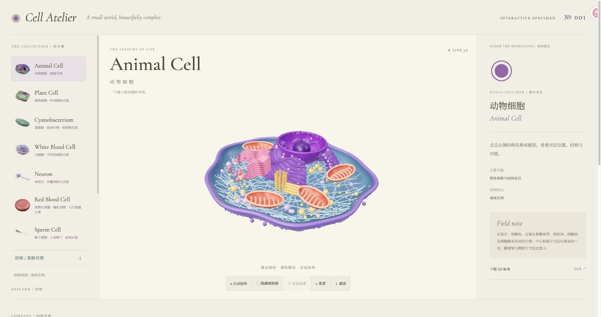

> 上图为当前网页在 Chrome 中的实际截图。下方细胞图册为仓库 GLB 模型在 Blender 中重新渲染的静态预览；两者的灯光与材质呈现会有差异。

[效果图册](#效果图册) · [植物细胞观察模式](#植物细胞观察模式) · [快速开始](#快速开始) · [操作指南](#操作指南) · [模型重建](#模型重建) · [常见问题](#常见问题)

## 能做什么

| 功能 | 使用方式 |
| --- | --- |
| 浏览七类细胞 | 点击左侧带模型缩略图的标本名称，切换 3D 模型与结构列表 |
| 点选结构 | 点击结构名称或模型表面；查看轮廓、引线、中文名称与功能笔记 |
| 观察空间关系 | 拖动旋转、滚轮缩放；使用自动旋转从多个角度观察 |
| 排除遮挡 | 隐藏单独建模的细胞膜，或将选中结构单独显示 |
| 植物细胞三种视图 | 在整体、剖面与透明外壳之间切换；开启可点击结构标签 |
| 比较细胞 | 使用页面下方动物细胞、植物叶肉细胞与蓝细菌的结构对照表 |
| 导出与复用 | 下载当前标本的 GLB；保存 WebGL 模型截图 |

可用于课堂投屏、课前预习与结构辨认练习。教师可以先让学生观察整体，再依次定位结构并讨论形态与功能。模型属于教学简化示意，使用范围见[教学范围](#教学范围)。

## 效果图册

以下七张图直接使用 `public/` 中的当前 GLB 渲染，背景透明。它们展示模型本身；网页中的结构选择、标签和笔记需要本地运行后体验。

### 动物细胞 · Animal Cell

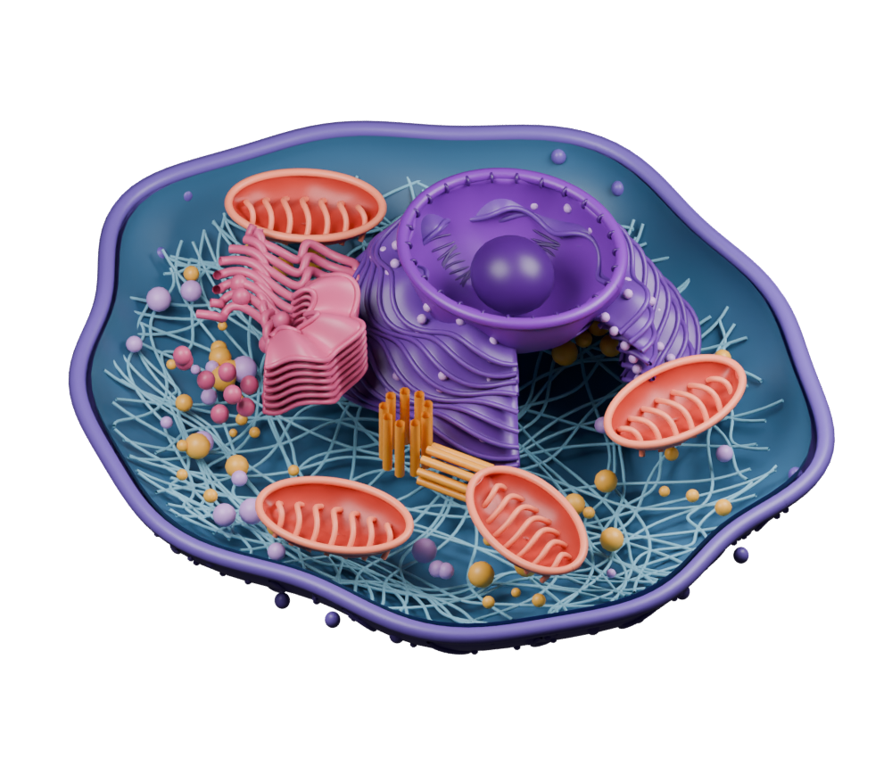

典型有核动物细胞剖面。包含细胞核、线粒体、内质网、高尔基体、细胞膜、细胞骨架、中心粒、囊泡和核糖体九类可选结构。模型表现线粒体内部嵴、粗面内质网片层、光面内质网管道及一对近似垂直的中心粒。

<details>
<summary>查看动物细胞精修渲染大图</summary>

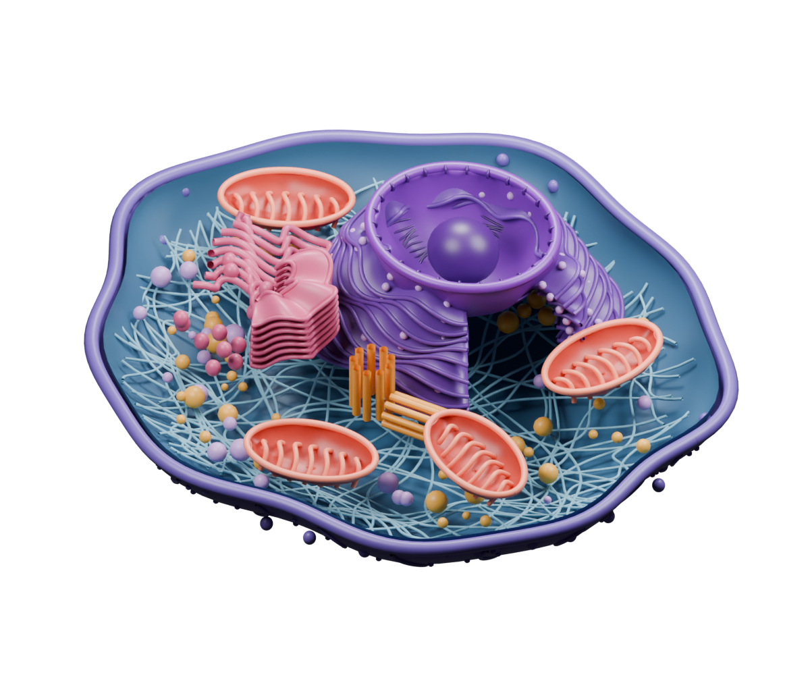

该图来自精修建模脚本的渲染场景，灯光与网页预览不同。

</details>

### 植物叶肉细胞 · Plant Cell

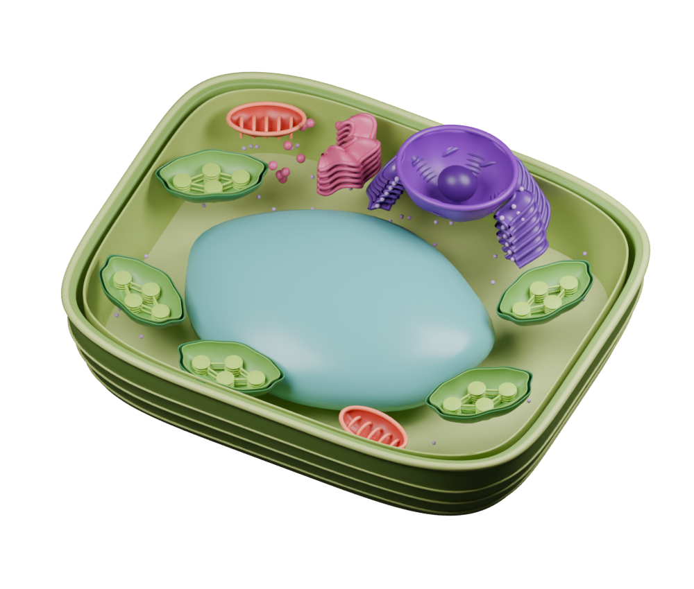

以成熟叶肉细胞为参考。中央液泡占据较大空间，细胞核和其他细胞器主要分布在外围。九类可选结构：细胞核、叶绿体、中央液泡、细胞壁、细胞膜、线粒体、内质网、高尔基体和核糖体。叶绿体剖面包含双层包膜示意、基粒堆叠及连接片层。

<details>
<summary>查看植物细胞精修渲染大图</summary>

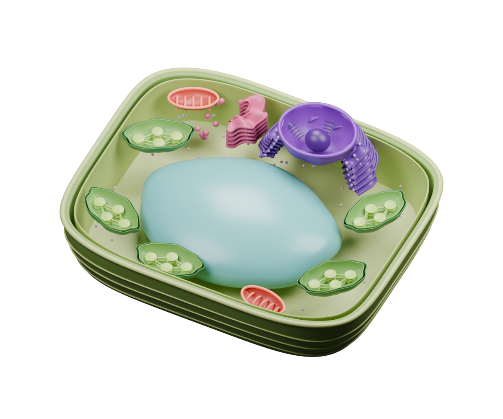

</details>

### 蓝细菌 · Cyanobacterium

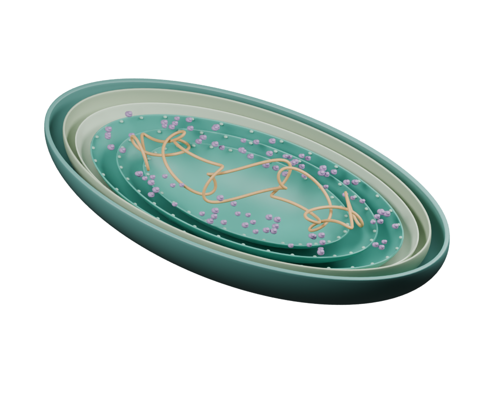

具类囊体的单细胞蓝细菌示意。可选结构为拟核、核糖体、类囊体、细胞膜、细胞壁与外膜、细胞质。拟核 DNA 没有核膜包围；光合膜直接位于细胞内部，不属于叶绿体。

### 中性粒细胞 · White Blood Cell

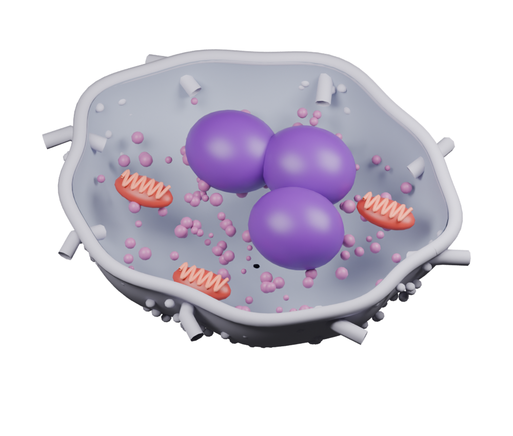

白细胞标本选用中性粒细胞。可观察分叶细胞核、胞质颗粒、线粒体和细胞膜。不同类型的白细胞形态存在差异，本模型不代表所有白细胞。

### 有髓神经元 · Neuron

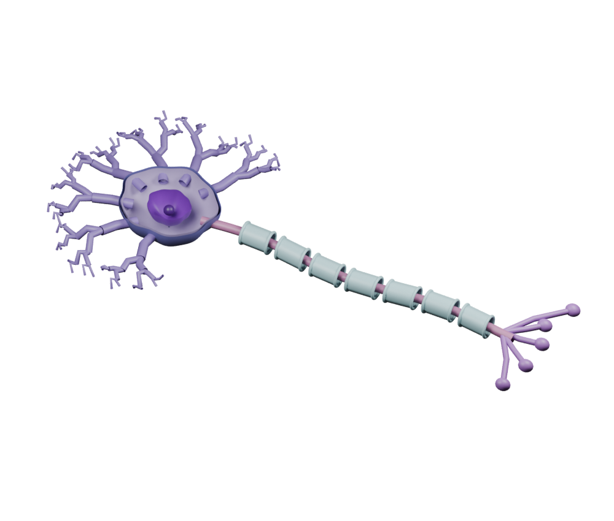

可选结构包含胞体、细胞核、树突、轴突、髓鞘、轴突末梢和胞体膜。分段髓鞘与节间间隙用于辅助理解轴突的空间结构；形成髓鞘的胶质细胞未绘出。

### 哺乳动物成熟红细胞 · Red Blood Cell

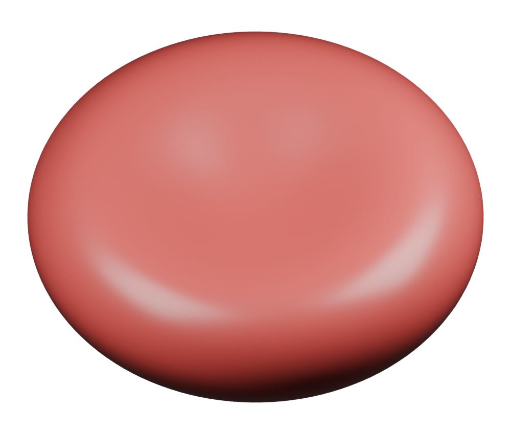

双凹圆盘，中央薄、周缘厚，两面凹陷但不穿孔。提供细胞膜与含血红蛋白的细胞质两个选择入口；选择细胞质会自动隐藏外膜。人类成熟红细胞没有细胞核、线粒体和核糖体。

### 人类精子 · Sperm Cell

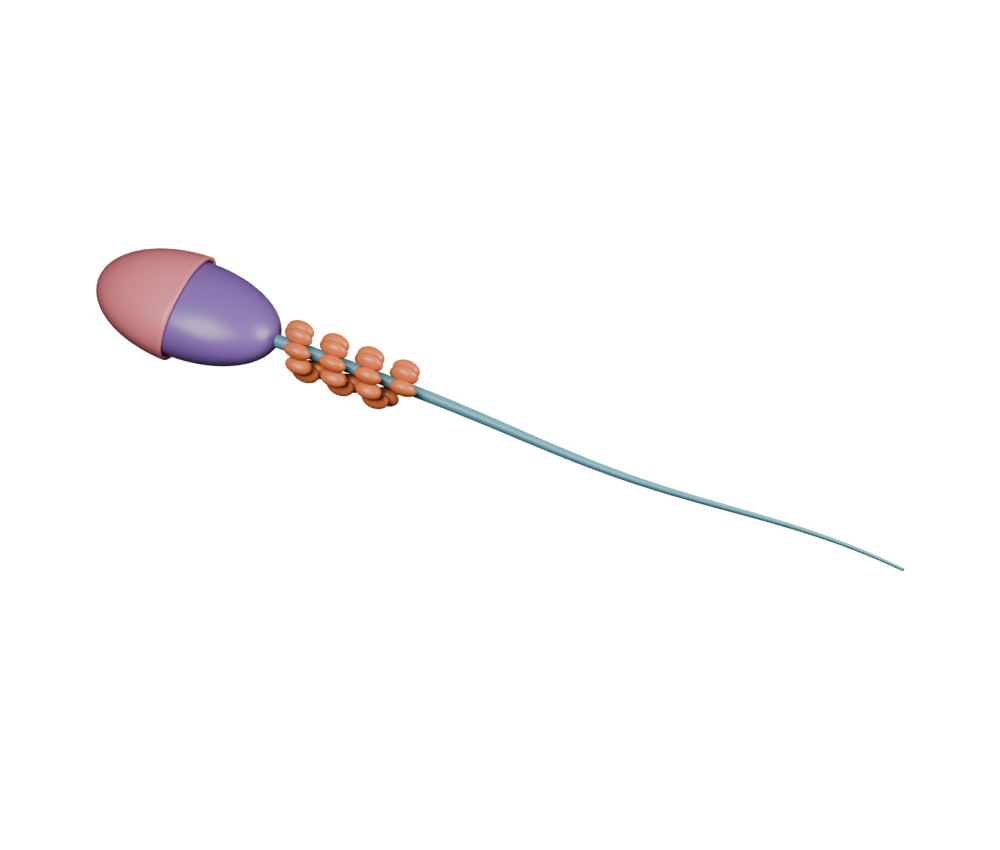

包含顶体、细胞核、线粒体鞘和渐细鞭毛四类可选结构。头部表现顶体与浓缩细胞核，中段用螺旋排列示意线粒体鞘，长尾表现运动结构的整体形态。

## 植物细胞观察模式

植物细胞是目前支持三种视图的标本。模式使用独立 Blender 导出的闭合外壳与原有精修剖面配合显示。

| 模式 | 观察重点 | 当前行为 |
| --- | --- | --- |
| 整体 | 完整外形与外侧边界 | 显示闭合细胞壁和细胞膜；开启标签时仅标出外侧细胞壁 |
| 剖面 | 内部结构和相对位置 | 省略上部外壳，展示内部细胞器 |
| 透明 | 通过外壳定位内部结构 | 仅淡化闭合外壳，内部模型保留；标签可点击选择结构 |

**剖面：观察内部细胞器。**

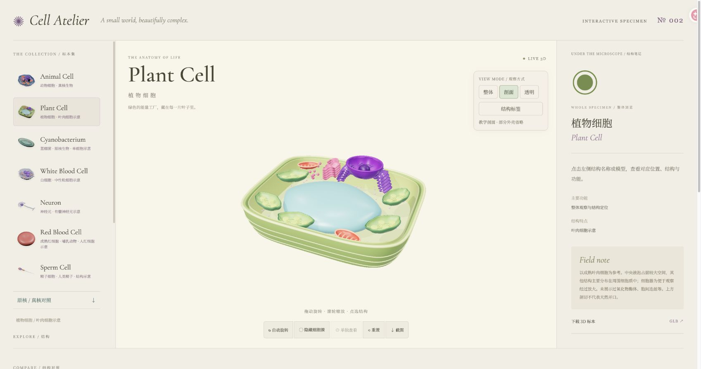

**整体：观察闭合外形。**

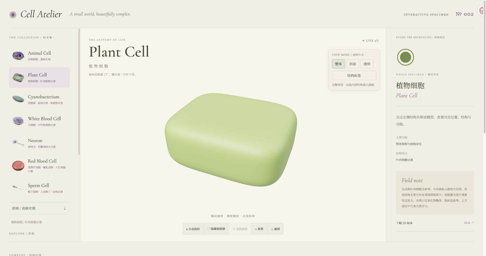

**透明与标签：同时定位九类结构。**

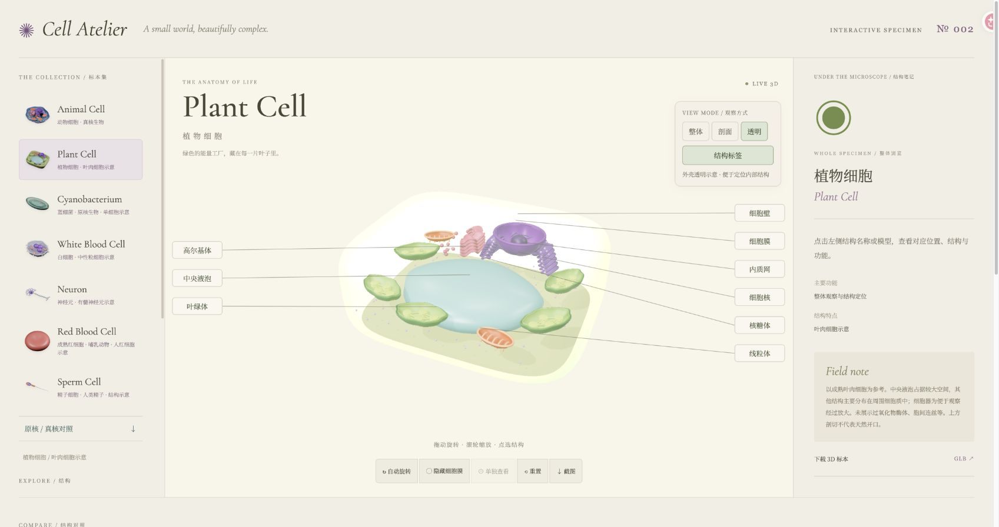

在整体模式点击左侧内部结构名称，会自动进入剖面以便观察。重置会清除结构选择，恢复默认剖面并关闭全部标签。其他六类标本目前使用各自原有的模型展示方式。

## 快速开始

### 环境

- Node.js **20.19+（20.x）或 22.12+**，推荐使用满足要求的 LTS 版本。
- npm；Chrome、Edge、Firefox 或 Safari 等支持 WebGL 的现代浏览器。
- 运行网页不需要 Blender。只有重建模型或重新渲染图片时需要安装 Blender。

### 克隆与运行

```bash
git clone https://github.com/Irissunsun/cell-atelier.git
cd cell-atelier
npm ci
npm run dev -- --port 5188
```

打开 **http://127.0.0.1:5188/**。保持开发服务运行；关闭服务后浏览器将无法连接。首次进入或切换标本时需加载 GLB，页面会显示加载提示。

### 测试与构建

```bash
npm test
npm run build
npm run preview
```

`npm test` 运行现有资产与教学文字检查；`npm run build` 生成 `dist/`。预览地址以终端输出为准。

## 操作指南

| 操作 | 结果 |
| --- | --- |
| 点击左侧标本 | 切换细胞及其可选结构、笔记和下载链接 |
| 拖动模型 | 围绕观察目标旋转 |
| 滚轮 | 缩放模型 |
| 点击结构名称 / 模型 | 更新右侧名称、功能、结构特点和示意说明；高亮目标 |
| 自动旋转 | 开启或停止持续旋转；选择结构时停止旋转 |
| 隐藏细胞膜 / 胞体膜 | 隐藏独立膜层；精子没有独立可选的细胞膜层 |
| 单独查看 | 仅显示当前选择的结构；尚未选择时按钮不可用 |
| 重置 | 恢复默认视角与概览，清除单独查看和膜隐藏状态 |
| 截图 | 下载模型画面的 PNG，HTML 标签和右侧笔记不包含在内 |
| 下载 3D 标本 | 下载当前标本原始 GLB；植物下载文件为剖面，不合并完整外壳 |

选中紧凑结构时镜头会适度拉近；拖动可以中断镜头过渡。系统开启“减少动态效果”时，镜头直接切换到目标视角。

## 结构对照与教学范围

页面下方的对照表比较典型有核动物细胞、植物叶肉细胞和蓝细菌：是否有核膜包围的细胞核、细胞壁、核糖体、线粒体、叶绿体，以及能否光合作用。表格中的“查看 3D”会跳转至对应标本。

<a id="教学范围"></a>

模型是艺术化、简化的教学示意，颜色与比例并非真实；尚未完成生物学专业审核。剖切开口用于观察内部，不代表天然开口。

- **植物细胞**：叶肉细胞含叶绿体，不能推广为“所有植物细胞都有叶绿体”。过氧化物酶体、胞间连丝等结构未展示。
- **动物细胞**：对照表中的动物列为典型有核体细胞，不包含哺乳动物成熟红细胞等特例。
- **蓝细菌**：没有叶绿体但能进行光合作用；拟核不是细胞核。DNA 形态、膜厚和颗粒数量经过简化。
- **中性粒细胞**：不代表所有白细胞；颗粒未按类型和真实染色区分。
- **神经元**：胞体与细胞核采用剖切。胶质细胞及多种胞内细胞器未完整建模。
- **成熟红细胞**：限定人类 / 哺乳动物成熟红细胞；无核特征不能推广到所有动物的红细胞。
- **精子**：限定人类结构示意；轴丝“9+2”、外致密纤维等超微结构没有逐层展示。

各标本右侧笔记说明具体展示范围。模型没有画出的结构，不应据此判断生物本身没有该结构。

## 模型重建

仓库包含可编辑 `.blend`、网页 `.glb` 和 Python 生成脚本。当前资产在 **Blender 5.2.1** 中生成；其他版本尚未逐一验证。

| 标本 / 资产 | 脚本 | 输出 |
| --- | --- | --- |
| 动物细胞精修 | `build_animal_detailed.py` | `animal-cell.blend`、`public/animal-cell.glb` |
| 植物细胞精修 | `build_plant_detailed.py` | `plant-cell.blend`、`public/plant-cell.glb` |
| 植物闭合外壳 | `build_plant_shells.py` | `plant-shells.blend`、`public/plant-shells.glb` |
| 蓝细菌 | `build_cyanobacterium.py` | `cyanobacterium.blend`、`public/cyanobacterium.glb` |
| 中性粒细胞、神经元及基础植物版本 | `build_variants.py` | 三类对应 `.blend` 与 `.glb` |
| 成熟红细胞 | `build_red_blood_cell.py` | `red-blood-cell.blend`、`public/red-blood-cell.glb` |
| 精子 | `build_sperm_cell.py` | `sperm-cell.blend`、`public/sperm-cell.glb` |
| 网页列表缩略图 | `render_thumbnails.py` | `public/thumbnails/*.png` |
| README 图册 | `render_gallery.py` | `docs/images/gallery/*.png` |

`build_cell.py` 提供原始动物细胞构建与其他脚本复用的几何工具。运行它会生成原始动物模型；当前精修动物版本使用 `build_animal_detailed.py`。

### 单独重建植物细胞

从仓库根目录，在独立后台进程运行：

```bash
blender --background --factory-startup --python build_plant_detailed.py
blender --background --factory-startup --python build_plant_shells.py
blender --background --factory-startup --python render_thumbnails.py -- plant-cell
blender --background --factory-startup --python render_gallery.py -- plant-cell
```

macOS 未将 Blender 加入 PATH 时，将 `blender` 替换为 `/Applications/Blender.app/Contents/MacOS/Blender`。

### 重建全部当前模型

```bash
blender --background --factory-startup --python build_variants.py
blender --background --factory-startup --python build_animal_detailed.py
blender --background --factory-startup --python build_plant_detailed.py
blender --background --factory-startup --python build_plant_shells.py
blender --background --factory-startup --python build_cyanobacterium.py
blender --background --factory-startup --python build_red_blood_cell.py
blender --background --factory-startup --python build_sperm_cell.py
blender --background --factory-startup --python render_thumbnails.py
blender --background --factory-startup --python render_gallery.py
npm test
npm run build
```

`build_variants.py` 会覆盖植物、中性粒细胞和神经元，因此精修植物脚本必须在它之后执行。生成脚本会清空运行进程的场景，请使用独立后台 Blender，勿在有未保存工作的窗口中直接运行。

## 项目结构与实现

```text
cell-atelier/
├── index.html                # 页面布局、结构笔记、对照表
├── src.js                    # GLB 加载、材质、选择与视图状态
├── specimens.js              # 标本配置与教学说明
├── focus-view.js             # 选中轮廓、引线与镜头过渡
├── view-labels.js             # 植物结构标签
├── style.css                 # 基础样式
├── refinements.css           # 布局、响应式与视图控件
├── public/                   # GLB、列表缩略图
├── *.blend                   # 可编辑 Blender 源文件
├── build_*.py                # 程序化建模与资产导出
├── render_thumbnails.py      # 网页缩略图渲染
├── render_gallery.py         # README 图册渲染
├── docs/images/              # 精修渲染、图册及网页截图
└── tests/                    # 资产与部分内容检查
```

Blender 生成几何并按 `organelle` 写入结构标识，导出 GLB；网页通过 `GLTFLoader` 加载模型，结合 `specimens.js` 将网格映射为可点选结构。页面使用 OrbitControls、轮廓后处理和 DOM 标签完成观察与定位。网页微表面纹理由前端生成，不包含在下载 GLB 中。

测试覆盖部分 GLB 分组、植物外壳闭合性、成熟红细胞双凹几何和部分教学文字边界；不等同于完整的生物学或视觉审核。

## 部署

运行 `npm run build` 后，可将 `dist/` 部署到支持静态文件的网站服务。

当前模型、缩略图和下载链接使用 `/` 开头的资源路径，适合放在域名根路径。**GitHub Pages 的仓库子路径需要同时调整 Vite base、模型 URL、缩略图 URL 与下载地址**；仅改变 Vite base 不足以修正运行时写死的资源路径。

本仓库提供源码，目前没有配置在线演示站。Google Fonts 通过网络加载，不可访问时回退到系统字体。

## 常见问题

**浏览器提示无法访问本地地址？**

确认终端里的开发服务仍在运行，并使用终端显示的端口。`127.0.0.1` 指向当前设备：手机打开该地址并不会连接到电脑上的服务。

**端口 5188 已被占用？**

换一个端口，例如 `npm run dev -- --port 5189`，使用终端输出的新地址。

**模型空白或加载失败？**

请通过 Vite 或构建后的静态服务打开，避免直接双击 `index.html`。检查浏览器支持 WebGL，且模型请求没有 404。部署在子路径时尤其要核对资源 URL。

**需要 Blender 才能体验网页吗？**

不需要。仓库已经包含导出的 GLB；安装 Node.js 后即可运行。Blender 用于编辑、重建模型和渲染图册。

**为什么网页和渲染图看起来不完全一致？**

Blender 图使用 Cycles 和独立灯光；网页使用 Three.js 的实时灯光、环境贴图及后处理。README 的网页截图呈现实际界面，图册帮助查看模型细节。

**为什么截图没有结构标签？**

工具栏截图导出的是 WebGL 画布，标签与笔记属于 HTML。需要保存完整界面时，请使用浏览器或系统截图。

**植物整体模型在哪里？**

完整外壳是 `public/plant-shells.glb`，网页与 `public/plant-cell.glb` 配合使用。下载按钮提供原始剖面模型，不会将两者合并。

## 许可与贡献

代码、建模脚本及本仓库生成的模型和渲染图使用 [MIT License](LICENSE)。第三方依赖的许可见 [THIRD_PARTY_NOTICES.md](THIRD_PARTY_NOTICES.md)。通过 Google Fonts 加载的字体遵循各自许可，本仓库未打包字体文件。

欢迎提交 [Issue](https://github.com/Irissunsun/cell-atelier/issues) 反馈教学文字、结构关系、显示问题或新标本需求。报告显示问题时，请说明浏览器、设备、标本名称与操作步骤；教学内容纠错请附可核对的来源。

修改模型时保留 `organelle` 分组与可选结构的对应关系，更新缩略图，并运行 `npm test` 与 `npm run build`。新加入的第三方资产请记录来源和授权。
